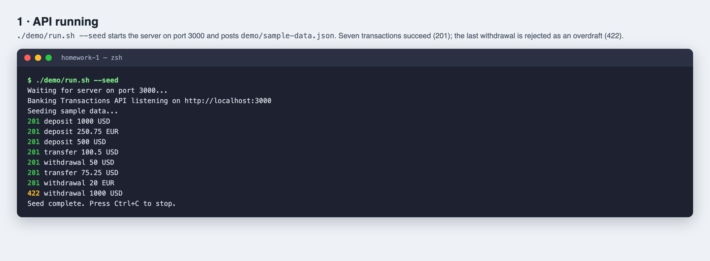
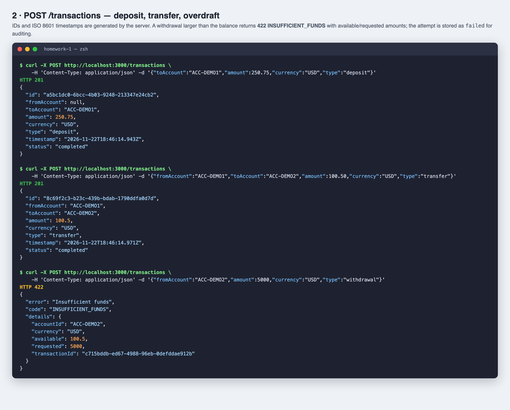
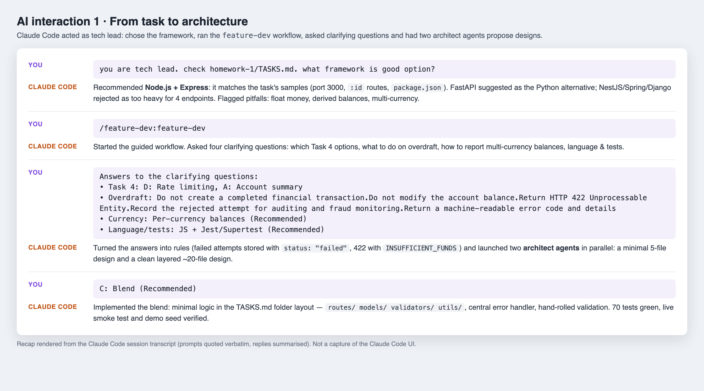

# 🏦 Homework 1: Banking Transactions API

> **Student Name**: Yuliya Izmaylova
> **Date Submitted**: 21-11-2026
> **AI Tools Used**: Claude Code

---

## 📋 Project Overview

A minimal REST API for banking transactions built with **Node.js + Express 5**, using in-memory storage. It supports deposits, withdrawals and transfers with strict validation, filterable transaction history, per-currency account balances, an account summary endpoint and per-IP rate limiting. See [HOWTORUN.md](HOWTORUN.md) to run it.

## ✅ Features Implemented

| Task | Feature | Status |
|------|---------|--------|
| 1 | Core endpoints, in-memory storage, status codes, error handling | ✅ |
| 2 | Validation: amount (positive, ≤ 2 decimals), `ACC-XXXXX` accounts, ISO 4217 currencies, per-type account rules | ✅ |
| 3 | History filters: `accountId`, `type`, `from`/`to` — combinable | ✅ |
| 4A | `GET /accounts/:accountId/summary` | ✅ |
| 4D | Rate limiting — 100 requests/min per IP → `429` | ✅ |
| — | Automated tests (Jest + Supertest, 85 tests) | ✅ |

## 🔌 API

| Method | Endpoint | Success | Errors |
|--------|----------|---------|--------|
| `POST` | `/transactions` | `201` transaction | `400` validation / malformed JSON, `413` body > 100kb, `415` unsupported charset, `422` insufficient funds |
| `GET` | `/transactions?accountId=&type=&from=&to=` | `200` array | `400` invalid filter |
| `GET` | `/transactions/:id` | `200` transaction | `404` |
| `GET` | `/accounts/:accountId/balance` | `200` `{ accountId, balances: { USD: 100.5 } }` | `400` bad account id |
| `GET` | `/accounts/:accountId/summary` | `200` `{ accountId, totalDeposits, totalWithdrawals, transactionCount, mostRecentTransactionDate }` | `400` bad account id |

All endpoints may also return `429` (rate limit) and `400` for malformed URL encoding (e.g. `%E0%A4%A`). Unknown routes return a JSON `404`.

**Transaction rules by type**

| Type | `fromAccount` | `toAccount` |
|------|---------------|-------------|
| `deposit` | must be absent | required |
| `withdrawal` | required | must be absent |
| `transfer` | required | required, different from `fromAccount` |

**Error format**
```json
{ "error": "Validation failed",
  "details": [ { "field": "amount", "message": "Amount must be a positive number" } ] }
```
```json
{ "error": "Insufficient funds", "code": "INSUFFICIENT_FUNDS",
  "details": { "accountId": "ACC-12345", "currency": "USD", "available": 30, "requested": 50,
               "transactionId": "…" } }
```

## 🏗️ Architecture

```
src/
├── index.js                         entry point — only place that calls listen()
├── app.js                           createApp(): rate limiter → JSON parser → routers → 404 → error handler
├── routes/
│   ├── transactions.js              POST /, GET /, GET /:id
│   └── accounts.js                  GET /:accountId/balance, GET /:accountId/summary
├── models/
│   └── store.js                     in-memory ledger: create, list/filter, balances, summary
├── validators/
│   └── transactionValidator.js      body, query-filter and account-id validation
└── utils/
    ├── money.js                     integer minor-unit helpers
    └── errors.js                    AppError (status + code + details)
tests/                               Jest + Supertest
demo/                                run.sh, sample-requests.http, sample-data.json
```

**Request flow (`POST /transactions`):** rate limiter → `express.json()` → `validateTransaction()` (throws `400` with every field error) → `store.createTransaction()` checks the source balance → `201` with the transaction, or `422` for insufficient funds. Errors are thrown as `AppError` and serialised by a single central error handler. Express 5 sends thrown errors to that handler automatically.

## 🧠 Key Decisions

- **Express 5, plain JavaScript (CommonJS).** It is small, needs no build step, and uses the same `:id` routes and port 3000 as the task's examples. `createApp()` is kept separate from `listen()` so tests run without opening a port.
- **Balances are derived, not stored.** A balance is calculated from *completed* transactions, so the transaction list is the single source of truth and can't fall out of sync.
- **Money as integer cents.** All arithmetic is done in minor units (`Math.round(amount * 100)`) to avoid float errors, e.g. `0.1 + 0.2` gives exactly `0.3`. Amounts must have exactly 2 decimals or fewer (checked exactly, with no error margin) and be at most 1,000,000,000, so cent totals stay well within JavaScript's safe-integer range.
- **Per-currency balances.** An account can hold several currencies. Balances and summary totals are reported per currency (`{ USD: …, EUR: … }`) instead of being converted between currencies.
- **Overdraft → `422 Unprocessable Entity`.** A withdrawal or transfer larger than the source balance in that currency is rejected and the balance is not touched. The attempt is still **recorded with `status: "failed"`** and a `failureReason`, for auditing and fraud monitoring. The response includes a machine-readable `code` and the stored `transactionId`. `422` is used rather than `400` because the request is well formed but breaks a business rule.
- **Transaction status.** Transactions are processed synchronously, so they are `completed` or `failed` straight away. The spec's `pending` status is never produced.
- **Implicit accounts.** Accounts have no registry, so an account with no transactions returns `200` with empty balances instead of `404`. A malformed account ID returns `400`.
- **Summary semantics.** It counts completed transactions only. `totalDeposits` covers deposits plus incoming transfers, and `totalWithdrawals` covers withdrawals plus outgoing transfers.
- **Date filters.** `from` and `to` accept `YYYY-MM-DD` or a full ISO 8601 datetime. A date-only `to` includes the whole day (UTC). Impossible calendar dates such as `2024-02-31` are rejected with `400` (JavaScript would otherwise silently roll them over to March).
- **Hand-written validation.** The task's error format is `{field, message}` with all errors collected. A small validator returns that directly, so no schema library or adapter is needed.
- **Rate limiting** uses `express-rate-limit` (in-memory, per IP) and sends standard `RateLimit-*` and `Retry-After` headers. Behind a reverse proxy, `trust proxy` would need configuring; that is out of scope here.

## 🤖 AI-Assisted Development

Built with **Claude Code**, using the `feature-dev` plugin workflow:
1. **Discovery.** Claude read `TASKS.md` and recommended a framework (Express vs FastAPI).
2. **Clarifying questions.** These settled the Task 4 options, overdraft behaviour, multi-currency balances, and language and tests.
3. **Architecture.** Two architect agents proposed a *minimal* design and a *clean layered* design. I chose a blend: minimal logic in the folder layout the task suggests.
4. **Implementation and tests.** The tests caught one wrong assumption in my own test (`1.005` is not a valid 2-decimal amount), which was fixed.
5. **Review.** Code-review agents checked the code for bugs and simplicity.
6. **Additional code review.** Code-review custom agent code reviewer built on the Karpathy guidelines.

## 📸 Screenshots

All terminal screenshots show real output from the running API (`docs/screenshots/`).

| # | Screenshot | Shows |
|---|------------|-------|
| 1 | [API running](docs/screenshots/01-api-running.png) | `./demo/run.sh --seed` starts the server and loads the sample data |
| 2 | [Create transactions](docs/screenshots/02-create-transactions.png) | Deposit and transfer (`201`), overdraft rejected (`422`) |
| 3 | [Validation errors](docs/screenshots/03-validation-errors.png) | Field-level `400` details, malformed JSON, `404` |
| 4 | [History filters](docs/screenshots/04-history-filters.png) | `accountId`, `type`, date-range filters, invalid filters |
| 5 | [Balance & summary](docs/screenshots/05-balance-summary.png) | Per-currency balances, account summary (Task 4A) |
| 6 | [Rate limiting](docs/screenshots/06-rate-limit.png) | Request #101 within a minute → `429` (Task 4D) |
| 7 | [Tests](docs/screenshots/07-tests-passing.png) | All 85 Jest tests passing |
| 8 | [AI interaction 1](docs/screenshots/ai-prompt-1-planning.png) | Prompts → framework choice, clarifying questions, architecture |
| 9 | [AI interaction 2](docs/screenshots/ai-prompt-2-review-loop.png) | Review agents → reproduced bugs → fixes |





<div align="center">

*This project was completed as part of the AI-Assisted Development course.*

</div>
